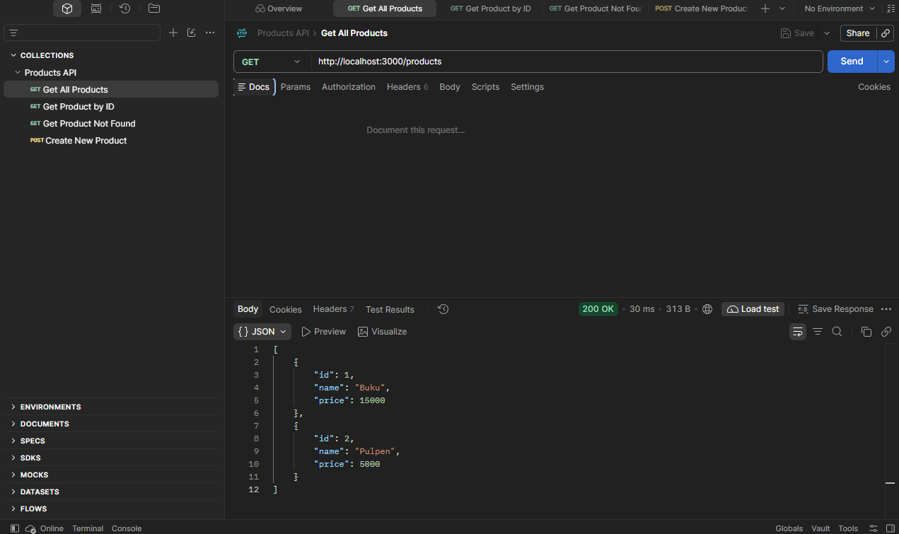
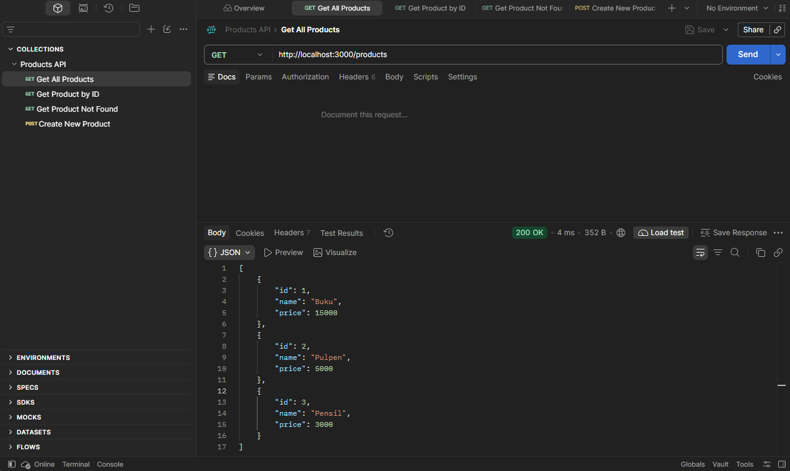
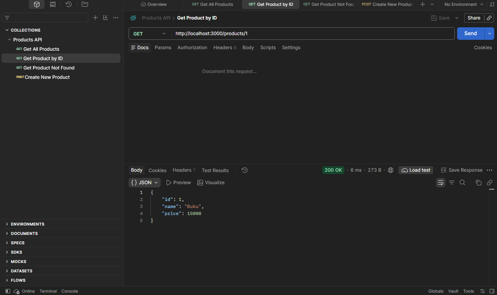
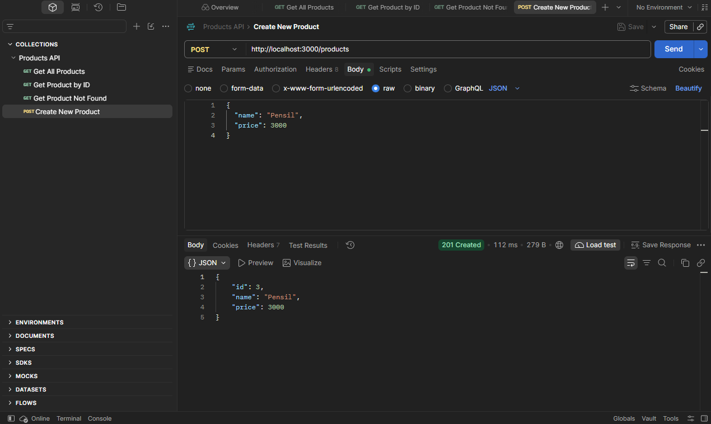
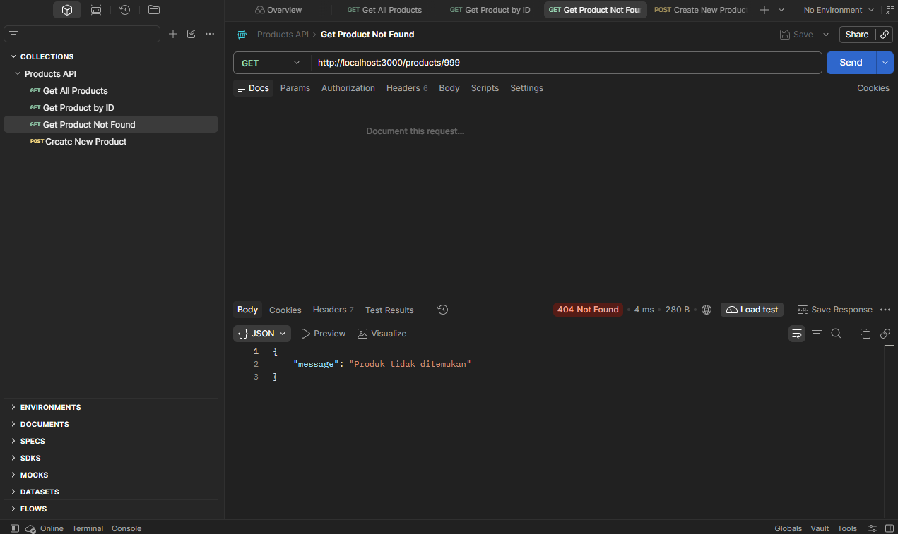

# Screenshot Tugas Minggu ke-9

Screenshot berikut mendokumentasikan pengujian API produk sebelum integrasi PostgreSQL.

## GET semua produk

## GET semua produk setelah POST

## GET produk berdasarkan ID

## POST membuat produk

## Produk tidak ditemukan

