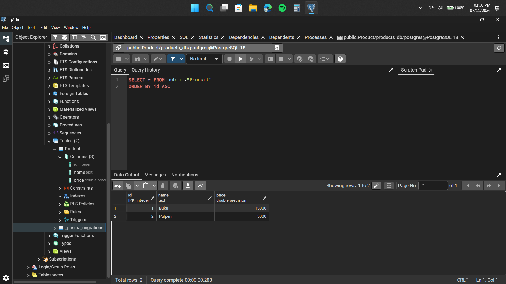
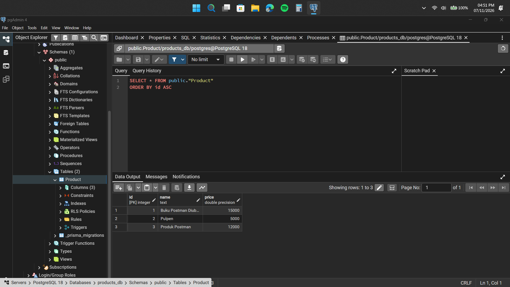
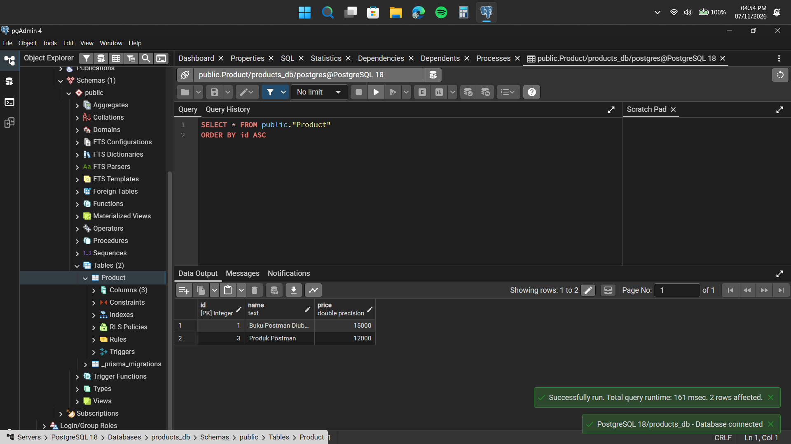

# Laporan Evidence: API Daftar Produk

## Identitas

- Nama: I Made Tobby Anantha Adiwijaya
- NRP: 5027251064
- Kelas: Pemrograman Web (C)

## Ringkasan

API produk menggunakan Express, Prisma, dan PostgreSQL. Seluruh 13 skenario pada screenshot Postman menunjukkan status respons sesuai hasil yang diharapkan. URL dan ID pada collection mengikuti request yang terlihat di screenshot.

## Persiapan

1. Pastikan PostgreSQL berjalan dan database `products_db` tersedia.
2. Isi `DATABASE_URL` di `.env` dengan kredensial PostgreSQL lokal.
3. Siapkan proyek dan database:

   ```bash
   npm install
   npx prisma generate
   npx prisma migrate dev
   npx prisma db seed
   npm run dev
   ```

4. Import [`postman/products-api.postman_collection.json`](postman/products-api.postman_collection.json) ke Postman.
5. Jalankan request sesuai urutan 01 sampai 13. Collection menggunakan ID contoh secara langsung: Buku memiliki ID 1, Pulpen memiliki ID 2, sedangkan ID 999 digunakan untuk skenario produk yang tidak ditemukan.

## Test cases

| ID | Skenario | Request | Input / prasyarat | Hasil yang diharapkan | Hasil aktual | Evidence |
|---|---|---|---|---|---|---|
| TC-01 | Mengambil semua produk | `GET /products` | Database telah di-seed | `200`; body berupa array produk | Berhasil: `200 OK`; Buku dan Pulpen tampil | [Screenshot](assets/week10/test-cases/1.png) |
| TC-02 | Mengambil produk yang ada | `GET /products/1` | Produk Buku dari seed | `200`; body berisi produk tersebut | Berhasil: `200 OK`; Buku tampil | [Screenshot](assets/week10/test-cases/2.png) |
| TC-03 | Mengambil produk yang tidak ada | `GET /products/999` | ID `999` tidak ada | `404`; pesan `Produk tidak ditemukan` | Berhasil: `404 Not Found` | [Screenshot](assets/week10/test-cases/3.png) |
| TC-04 | Membuat produk | `POST /products` | `{"name":"Produk Postman","price":12000}` | `201`; produk baru dengan ID otomatis | Berhasil: `201 Created`; produk tersimpan dengan ID `3` | [Screenshot](assets/week10/test-cases/4.png) |
| TC-05 | POST dengan nama kosong | `POST /products` | `{"name":"","price":12000}` | `400`; pesan `Nama dan harga produk tidak valid` | Berhasil: `400 Bad Request` | [Screenshot](assets/week10/test-cases/5.png) |
| TC-06 | POST dengan harga tidak valid | `POST /products` | `{"name":"Produk Uji","price":-1}` | `400`; pesan `Nama dan harga produk tidak valid` | Berhasil: `400 Bad Request` | [Screenshot](assets/week10/test-cases/6.png) |
| TC-07 | Memperbarui produk | `PUT /products` | ID `1`, nama `Buku Postman Diubah`, harga `15000` | `200`; body menampilkan nilai baru | Berhasil: `200 OK`; produk ID `1` berubah | [Screenshot](assets/week10/test-cases/7.png) |
| TC-08 | PUT dengan ID tidak valid | `PUT /products` | ID dikirim sebagai string `"abc"` | `400`; pesan `ID produk tidak valid` | Berhasil: `400 Bad Request` | [Screenshot](assets/week10/test-cases/8.png) |
| TC-09 | PUT untuk produk yang tidak ada | `PUT /products` | ID `999` dan data produk valid | `404`; pesan `Produk tidak ditemukan` | Berhasil: `404 Not Found` | [Screenshot](assets/week10/test-cases/9.png) |
| TC-10 | DELETE dengan ID tidak valid | `DELETE /products/abc` | ID bukan bilangan bulat positif | `400`; pesan `ID produk tidak valid` | Berhasil: `400 Bad Request` | [Screenshot](assets/week10/test-cases/10.png) |
| TC-11 | DELETE produk yang tidak ada | `DELETE /products/999` | ID `999` tidak ada | `404`; pesan `Produk tidak ditemukan` | Berhasil: `404 Not Found` | [Screenshot](assets/week10/test-cases/11.png) |
| TC-12 | Menghapus produk | `DELETE /products/2` | Produk Pulpen hasil seed dengan ID `2` | `200`; pesan `Produk berhasil dihapus` | Berhasil: `200 OK`; Pulpen berhasil dihapus | [Screenshot](assets/week10/test-cases/12.png) |
| TC-13 | Memastikan produk terhapus | `GET /products/2` | Produk Pulpen setelah TC-12 | `404`; pesan `Produk tidak ditemukan` | Berhasil: `404 Not Found`; Pulpen tidak lagi ditemukan | [Screenshot](assets/week10/test-cases/13.png) |

## Perubahan database

Screenshot berikut menunjukkan isi tabel `Product` pada tiga tahap pengujian.

### Sebelum operasi

Tabel berisi dua produk hasil seed: Buku (ID 1, harga 15000) dan Pulpen (ID 2, harga 5000).



### Selama pengujian

Setelah produk Postman dibuat dan Buku diperbarui, tabel berisi tiga baris: Buku Postman Diubah (ID 1), Pulpen (ID 2), dan Produk Postman (ID 3).



### Setelah penghapusan

Pulpen (ID 2) telah dihapus. Buku Postman Diubah (ID 1) dan Produk Postman (ID 3) masih tersimpan.



## Melihat tabel Product di pgAdmin

1. Buka **Servers > server PostgreSQL > Databases > products_db > Schemas > public > Tables**.
2. Klik kanan **Tables**, lalu pilih **Refresh**.
3. Klik kanan tabel **Product**, lalu pilih **View/Edit Data > All Rows**.
4. Setelah menjalankan request POST, PUT, atau DELETE, refresh tabel untuk melihat perubahan.

## Kesimpulan

GET, POST, PUT, dan DELETE berhasil dijalankan terhadap PostgreSQL. Screenshot Postman mendokumentasikan respons sukses, validasi gagal, serta produk yang tidak ditemukan. Screenshot database menunjukkan bahwa POST menambah baris, PUT mengubah data, dan DELETE menghapus produk.
